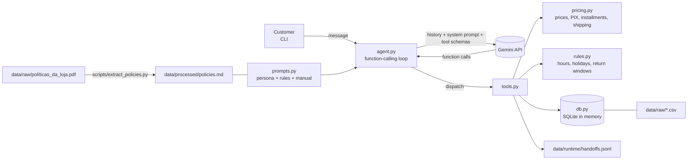

# Empório da Música — customer-service agent

A text-message customer-service agent for *Empório da Música*, a fictional musical-instrument store in
Campo Grande/MS, built for Artefact's AI Engineer technical case.

## Overview

The agent chats with customers in Brazilian Portuguese with the tone the store's manual asks for
("informal but professional, like a friend who knows music"). It answers:

- **catalog, price, stock and promotion questions**, by querying the store's tables;
- **payment and shipping questions** (PIX discount, interest-free installments, metropolitan shipping),
  computed by code from the manual's rules;
- **order status and return/exchange requests**, after verifying the order number plus the customer's
  e-mail or phone, counting the days against the manual's deadlines;
- **policy questions** (opening hours, payment methods, warranty, privacy), from the full manual, which
  sits in the system prompt;
- **out-of-scope requests** (accessories the store does not sell, unrelated topics), politely redirected;
- anything it cannot answer, by forwarding the case to the human team with a protocol number.

The core idea: **the model interprets and orchestrates; code calculates.** Every price, discount,
installment, shipping fee, stock level, order status and deadline the agent states comes from a tested
Python tool, never from the model. The manual demands the same (section 7.1: never give prices, stock or
deadlines without checking the system).

## Quickstart

Requirements: Python 3.11+ and a free Gemini API key.

**1. Get a free Gemini API key.** Go to [Google AI Studio](https://aistudio.google.com), sign in with a
Google account, open **Get API key → Create API key** and copy it. No billing is needed for the free tier.

**2. Install and configure.**

Windows (PowerShell):

```powershell
git clone https://github.com/rodrigoteixeiraferreira/emporio-da-musica-agent.git
cd emporio-da-musica-agent
python -m venv .venv
.\.venv\Scripts\Activate.ps1
pip install -r requirements.txt
Copy-Item .env.example .env   # then open .env and paste your key after GEMINI_API_KEY=
```

If PowerShell refuses to run `Activate.ps1`, allow it for the current window with
`Set-ExecutionPolicy -Scope Process Bypass` and activate again.

macOS / Linux:

```bash
git clone https://github.com/rodrigoteixeiraferreira/emporio-da-musica-agent.git
cd emporio-da-musica-agent
python3 -m venv .venv
source .venv/bin/activate
pip install -r requirements.txt
cp .env.example .env          # then open .env and paste your key after GEMINI_API_KEY=
```

**3. Chat.**

```bash
python -m emporio_agent --show-tools --today 2026-03-25T10:00
```

- `--show-tools` prints every tool call and its result.
- `--today` sets the store's "now" (`STORE_TODAY`). The order data ends in March 2026, so a date right
  after it (as above) makes order and return questions meaningful. Without it, the real current time is used.
- `--model` overrides `GEMINI_MODEL` (default `gemini-3.6-flash`).
- In the chat, `/reset` starts a new conversation and `/sair` quits.

Try, for example: *"Quais violões com captação vocês têm até R$ 1500?"*, *"Quanto custa o Takamine GD20 no
PIX?"*, *"Qual o status do pedido 8? Meu e-mail é anacarol.ferreira@coldmail.com"*, *"Vocês abrem
sábado?"*.

> The free tier of `gemini-3.6-flash` allows 20 requests per day, and each message uses 1 to 3 requests.
> For longer sessions use `--model gemini-3.5-flash-lite` (500 requests/day). Limits checked on 2026-11-04.

## Architecture



| Module | Responsibility |
|---|---|
| `src/emporio_agent/db.py` | Loads the six CSVs into an in-memory SQLite with types and normalization; text tokenizer. |
| `src/emporio_agent/policies.py` | Turns the manual PDF into Markdown (run once by `scripts/extract_policies.py`). |
| `src/emporio_agent/pricing.py` | Pure money rules: promotional price, PIX, installment bands, combined payment, shipping. |
| `src/emporio_agent/rules.py` | Pure date rules: opening hours and holidays, return/exchange windows, legal warranty. |
| `src/emporio_agent/tools.py` | The 8 tools the model can call, and their JSON schemas. |
| `src/emporio_agent/prompts.py` | System prompt: persona, hard rules, resolved inconsistencies, reference time, full manual. |
| `src/emporio_agent/agent.py` | The explicit loop *model → tool calls → results → model*, retries, history. The only Gemini-specific module. |
| `src/emporio_agent/cli.py` | Terminal chat (`python -m emporio_agent`). |
| `scripts/run_examples.py` | Runs the example scenarios on the real model and writes `examples/*.md`. |

**Tools**

| Tool | What it does |
|---|---|
| `search_products` | Catalog search by keywords, category and price range. Returns final price (with active promotion), PIX price, max installments and stock. Hides unavailable items by default but lists them apart. |
| `get_product` | One product by name or id: full price breakdown (list, promotion, PIX, every installment option), stock, specs, expired promotions, alternatives when unavailable. Ambiguous or merely similar names return candidates, never a confirmed product. |
| `quote_order` | Several items/quantities: subtotal, shipping, total, PIX total, installments, combined-payment eligibility, stock warnings. |
| `list_active_promotions` | Active promotions with original price, discount and promotional price. |
| `get_order_status` | Status, items, tracking, delivery estimate (flags late shipments), cancellation reason. Requires order number + e-mail or phone. |
| `check_return_eligibility` | Regret / defect / preference windows counted against the order dates; alternatives (legal and manufacturer's warranty). Same verification. |
| `get_store_status` | Open or closed now (Campo Grande time zone, holidays), today's hours, next opening. |
| `escalate_to_human` | Records the case in `data/runtime/handoffs.jsonl` and returns a protocol with the 24-business-hour return time. |

## Technical decisions and why

**Model and provider: Gemini API, free tier (`gemini-3.6-flash`).** The case allows free models, and the
free tier means a reviewer can run the project without paying anything. On 2026-11-04 I checked the
official docs and in Google AI Studio's rate-limit page: the free tier offers `gemini-3.8-flash` and
`gemini-3.6-flash` (stable) and `gemini-3-flash-preview`, all with function calling, 5 requests/min and
20 requests/day each. I planned to use the newest, `gemini-3.8-flash`, but when generating the final
examples it answered `503 UNAVAILABLE — high demand` for several minutes, while `gemini-3.6-flash`
answered normally. I chose the model that works reliably for a reviewer today over the newest one, and
made it the default. Development and the live smoke test used `gemini-3.5-flash-lite` (15/min,
500/day) to spare the Flash quota. The model is one environment variable (`GEMINI_MODEL`) or flag
(`--model`) away.

**Native function calling in an explicit loop, no framework.** The task is a single agent with eight
tools. `agent.py` is about 170 lines: send the history, run the function calls the model asks for, send
the results back, stop when the model answers in text (or after 6 rounds). There is nothing for
LangChain/LangGraph to add here except a layer to learn and debug, and the loop being visible is part of
what is being evaluated. Automatic function calling in the SDK is also off for the same reason.

**The AI interprets; code calculates.** All business rules that produce a number or a yes/no live in
`pricing.py` and `rules.py` as pure functions with tests. Tools return money already formatted
(`R$ 2.199,00`) so the model never does arithmetic. The prompt forbids stating a figure that did not come
from a tool in the conversation, and `quote_order` exists so that "two of these, delivered to Campo
Grande" is also computed by code.

**The manual goes whole into the system prompt, no RAG.** It has 8 pages (~4k tokens). Retrieval would
add an embedding model, a vector store, chunking choices and a failure mode (the right paragraph not
being retrieved) to save tokens we do not need to save. The PDF is converted once to
`data/processed/policies.md`, versioned so anyone can read exactly what the model sees; a test fails if
it gets out of date. RAG is the next step if the manual grows by an order of magnitude.

**SQLite in memory.** The data is six small CSVs. SQLite is in the standard library, gives typed tables
and parameterized SQL, and loads in milliseconds at start-up. The CSVs stay the source of truth.

**Order data needs verification.** Order tools require the order number *and* the e-mail or phone of
that order's customer; a failed check returns the same message whether the order exists or not, and the
conversation is locked after three failures. The manual does not define this; it follows from its LGPD
section.

**Similar names never confirm a product.** `get_product` only returns a product when all the words the
customer typed match it (accents, plurals and "GD-20"/"GD20" are normalized). Otherwise it returns
candidates and the prompt tells the agent to ask.

**CLI interface.** The case says the focus is the agent working correctly; a terminal chat is the
smallest interface that shows it, including the tool calls (`--show-tools`).

**History in memory, per session.** The conversation history is kept while the CLI runs and cleared by
`/reset`. A customer-service conversation is short and persisting it would require deciding identity and
retention (LGPD) first; it is listed under next steps.

**Retries.** 429 and 5xx responses are retried with the server's suggested delay or exponential backoff;
an exhausted *daily* quota fails fast with a message suggesting another model.

## Data treatment

Done at load time in `db.py`, without changing the raw files (`data/raw/` is byte-identical to what was
received):

- **Types:** ids and quantities as integers, money as numbers (computed with `Decimal`), dates as ISO
  text, empty strings as `NULL`.
- **`specs` as JSON.** For guitars and basses the key `strings` holds the *number* of strings ("6"),
  while for acoustic instruments it holds the *material* ("nylon"/"steel"). The numeric one is renamed
  `string_count`.
- **Unreliable descriptions.** Six products have a description naming another brand (e.g. *Music Man
  Bass 1X* described as a "Fender Jazz Bass", *Korg Synth 1 Pro* as a "Roland" with 88 keys while its specs
  say 61). Those descriptions are hidden from the agent, which uses only name and specs for them.
- **Search index.** Each product gets normalized tokens (lower case, no accents, singular, letter/digit
  split) from name, brand, category, reliable description and specs, plus synonyms such as
  "eletroacústico"/"captação" for instruments with electronics.
- **Customer contact** normalized for verification: lower-cased e-mail, phone reduced to digits.
- **Order totals** are taken from `orders.total_brl` (order items have no historical price). Two orders
  differ from today's list prices (orders 3 and 20); the order total is treated as authoritative.

## Assumptions

Inconsistencies in the manual, and how the agent resolves them:

| Topic | Manual says | Decision |
|---|---|---|
| WhatsApp number | Cover/table: (67) 3341-4444 as "Telefone / WhatsApp"; section 7: WhatsApp is (67) 3321-4500 | WhatsApp = **(67) 3321-4500** (section 7 is the one about the channel); (67) 3341-4444 is the phone. |
| E-mail | With and without accent | **contato@emporiodamusica.com.br** (without accent; accents are not valid in most mail systems). |
| Installments | Section 3 table: up to 12x, minimum R$ 100; section 3.1: bands 1-3x / 4-6x (min R$ 80) / 7-12x (min R$ 100) | **Section 3.1**, the more specific rule. |
| Catalog size | "More than 300 instruments" | **The tables (65 products)**. Categories with no products (woodwinds, brass, orchestral strings) are reported as unavailable. |

Other assumptions:

- **"Exceto abaixo de R$ 50"** (3.1) is read as: purchases under R$ 50 cannot be split. Every product
  costs more than R$ 150, so the other reading (installments of at least R$ 50) gives the same results.
- **Installment values** are rounded half-up to the cent; installments are computed on the final price
  (with promotion) or, in a quote, on the total including shipping.
- **PIX** is 5% off the list price, only on items without an active promotion (6.2). In a quote, items
  on promotion keep their promotional price and shipping is not discounted.
- **Free shipping "above R$ 500"** is strict: an order of exactly R$ 500,00 pays R$ 35,00. It is computed
  on the products' final prices, before any PIX discount.
- **Metropolitan region:** the manual does not list its municipalities, so the R$ 35 / free rule is
  applied to Campo Grande only; other cities get the carriers and delivery times and a quote from the team.
- **Promotions** have no dates in the data; `is_active` is the only signal. If two were active for the
  same product, the larger discount would apply (they do not stack).
- **Return windows** count calendar days and include the last day. Regret: 7 days from receipt.
  Defect: 30 days from purchase (order date). **Preference: 7 days from receipt** (the manual does not
  say from when; receipt is the customer-friendly reading and matches the regret rule).
- **Receipt date:** for delivered orders the data only has `estimated_delivery`, taken as the receipt date.
- **Regret right (4.1) applies to online purchases;** every order in the data has a delivery, so all are
  treated as online.
- **Orders not yet shipped** (pending/confirmed): the manual has no cancellation rule, so the agent
  forwards them to the team.
- **Order status meaning:** pending = awaiting payment confirmation; confirmed = paid, being prepared.
- **Holidays:** national holidays, Mato Grosso do Sul's (11 Oct) and Campo Grande's anniversary (26 Aug).
  Carnival and Corpus Christi are optional days nationally and treated as regular days.
- **Time zone:** America/Campo_Grande (UTC-4).
- **24-business-hour return time** (7.3, defined for complaints) is used for every handoff.
- **Partner shops for accessories** (7.1 says "suggest partner shops when possible"): there is no list
  in the data, so the agent suggests a specialized shop without naming one.
- **Verification:** order number + e-mail or phone (at least the 9 local digits). One e-mail
  (`bruno.martins@jmail.com`) belongs to two customers in the data; since verification is per order, it
  only grants access to that customer's order.
- **Orders 3 and 14 contain the "coming soon" product** (130); they are shown as they are, without
  inferring pre-sale rules.

## Example conversations

Generated by `scripts/run_examples.py` against the real model with reference time 2026-03-25 10:00
(a Wednesday, three days after the last order). The files are not edited by hand; each header records
model, reference date, generation time and commit, and every tool call is expandable.

| # | Conversation | What it shows | Model |
|---|---|---|---|
| 1 | [Catalog search with a price ceiling](examples/01-catalog-search.md) | `search_products` by category and price; 12 guitars with PIX price and max installments; the out-of-stock and discontinued matches are mentioned apart. | `gemini-3.6-flash` |
| 2 | [Price, installments and PIX](examples/02-price-and-payment.md) | `get_product`: list price, the 10x option *and* the 12x maximum, PIX with 5% off. | `gemini-3.6-flash` |
| 3 | [Return request](examples/03-return-request.md) — **non-trivial** | Asks for order number + e-mail, verifies them, `check_return_eligibility` for regret (window ended 24/02/2026) and then for defect (30-day window ended 05/03/2026; legal warranty valid until 18/05/2026). | `gemini-3.6-flash` |
| 4 | [Accessories and an unrelated question](examples/04-out-of-scope.md) | Strings/amplifiers declined (instruments only), World Cup question redirected; no tool calls. | `gemini-3.6-flash` |
| 5 | [Expired promotion on an out-of-stock product](examples/05-expired-promotion-out-of-stock.md) — **non-trivial** | The 40% promotion has ended: current price, out of stock, three alternatives, then a `quote_order` with free shipping in Campo Grande. | `gemini-3-flash-preview` |

Example 5 was regenerated after reviewing its first version (still in the git history, commit
`2d3939a`): it offered a R$ 4.599 guitar as an alternative to a R$ 799,90 one, because the ranking
treated fragments of model codes ("GF-**3D**", "**D**-8") as shared words. The ranking was fixed and tested
(commit `64eccc8`) and the example generated again. By then `gemini-3.6-flash` had used its 20 daily
requests, so `gemini-3-flash-preview` was used.

## Tests

```bash
pytest                 # unit tests: data, pricing, rules, tools, agent loop (no network)
pytest -m live         # one smoke test against the real API (needs GEMINI_API_KEY)
```

The unit tests cover, among others: row counts and statuses; search filters (category, price ceiling,
exclusion of discontinued/coming-soon/out-of-stock); active promotion applied and inactive ignored; PIX
only without promotion; installment bands of 3.1 (including the R$ 80/R$ 100 boundaries); metropolitan
shipping; order verification (right, wrong, unknown order, lock-out); ambiguous and similar names; the
three return reasons in and out of their windows; opening hours and holidays; the agent loop with a
scripted fake model (tool round-trip, retry on 429, daily-quota failure, iteration limit).

The live test uses `gemini-3.5-flash-lite` by default (`GEMINI_TEST_MODEL` to change it).

## Known limitations and what I would do with more time

- **Free tier data use.** On the Gemini free tier, Google may use the content to improve its products.
  Real customer conversations would need the paid tier (or another provider with a data-processing
  agreement).
- **Rate limits, availability and latency.** 20 requests/day on the free Flash models, 5 per minute;
  responses took 10-20 s per request during development, and the newest Flash model was unavailable
  (503) for long stretches, with the failed attempts still counted against the daily quota. Production
  would use the paid tier and a fallback model.
- **Alternatives are ranked by a simple heuristic** (same category, shared name words, closest price).
  Good for this catalog; a real store would maintain "successor" and "similar" links per product.
- **Simplified identity verification.** Order number + e-mail/phone is a weak factor (both appear on
  receipts and e-mails). A real channel would rely on the WhatsApp number itself or a one-time code.
- **No automatic evaluation.** Tools are unit-tested, but the agent's answers are only checked by the
  examples and manual runs. Next step: a set of scripted conversations with expected tool calls and
  assertions on the answer (e.g. the exact prices appear, no price appears without a tool call), run on
  every prompt change.
- **RAG when the manual grows.** Whole-manual-in-prompt is right at 8 pages, not at 300.
- **Persistent history per customer**, keyed by the WhatsApp number, with a retention policy (LGPD).
- **Shipping outside Campo Grande** is not quoted; it would need the carriers' APIs (CEP, weight,
  dimensions), and the product table has no weight or dimensions.
- **Search is keyword-based.** Good enough for 65 products; for a larger catalog, embeddings or a proper
  search engine.
- **Holiday calendar** is hard-coded (no municipal optional days); a real store would maintain it.
- **Handoffs** go to a local JSONL file instead of a ticketing system.
- **WhatsApp integration** (the real channel) and a web/API interface were out of scope.

## AI coding assistant usage

I used **Claude Code** (model Claude Opus 5.5), in the terminal on Windows, plus its Chrome extension
for the Google AI Studio steps. How the work was split:

- **Before coding, I wrote a session brief** ([`docs/session-brief.md`](docs/session-brief.md), English
  translation of the Portuguese original). It fixed what the assistant could not decide alone: scope,
  non-negotiable rules ("the AI interprets, code calculates", no agent framework, manual in the prompt,
  verification before order data, examples generated only by code), the known data inconsistencies and
  how to resolve them, the stages, the tests each stage needs before a commit, and the points where it
  had to stop and ask me.
- **Claude Code implemented it stage by stage.** It read the statement, the manual and the CSVs first,
  wrote the code and the tests, and only committed and pushed with the tests green (the history shows
  that progression). Commits it wrote carry a `Co-Authored-By: Claude` trailer.
- **I decided at the pause points.** I authorized the creation of the public repository and of a
  dedicated Gemini API key (created in AI Studio through the browser extension and revoked after
  delivery; it was never committed). I also set the quota strategy: develop and test on
  `gemini-3.5-flash-lite` (500 requests/day) and spend the Flash quota (20/day) only on the final
  examples.
- **The assistant reported where my brief was wrong instead of "fixing" it silently.** The brief said
  64 products, 49 customers, 21 order items and 24 promotions; the data has 65, 50, 22 and 25. The tests
  use the real counts.
- **It checked facts instead of answering from memory.** It read the free-tier models and limits in the
  official docs and in AI Studio, and listed the models through the API with the key.
- **Iterating on behaviour with real runs.** The example scenarios were first run on Flash-Lite as a dry
  run. The issues found there became prompt fixes in a commit of their own (e.g. mention items that
  match a search but are unavailable, say the maximum number of installments when asked about 10x, look
  up a product whenever the customer names one, never refer to options not given). The final examples
  were then generated by `scripts/run_examples.py` and never edited by hand; reviewing them exposed the
  alternatives-ranking bug described above, which was fixed in code and the example regenerated.
- **Final review by a clean-context subagent.** A separate agent that saw only the challenge statement
  and this repository listed unmet requirements and README claims without support in the code.
